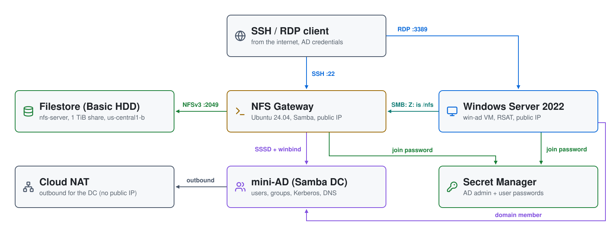
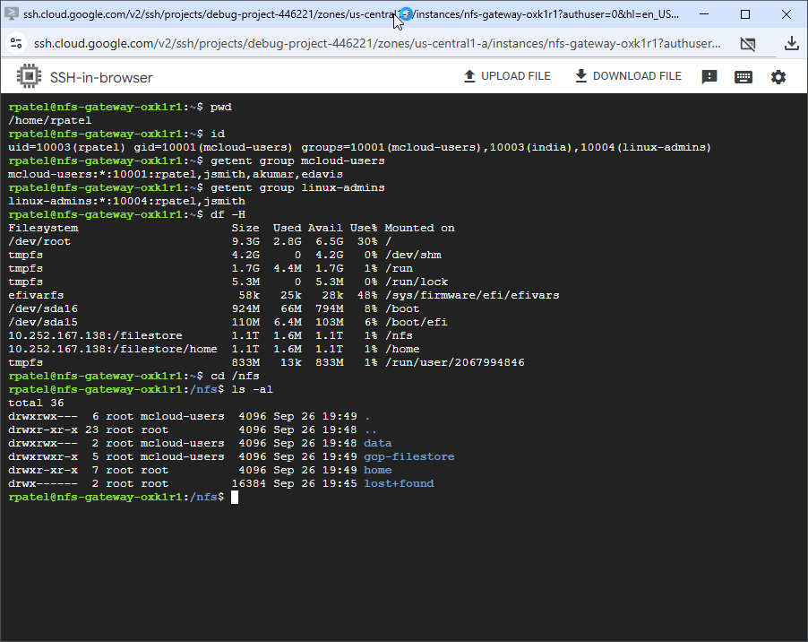

# Filestore + Active Directory on GCP: NFS and Samba File Sharing

Shared file storage for Linux and Windows, backed by a **Filestore** NFS share
and secured with a **mini-AD** domain. A Linux gateway mounts the share over
NFS for home directories and a shared area, and re-shares it over **SMB**, so
Windows VMs reach the same files as a mapped drive. Every login uses an AD
account.

| Piece | Where | Role |
|---|---|---|
| **NFS gateway** | `ad-subnet-filestore`, public IP | Ubuntu 24.04; joined to AD with SSSD; mounts the share as `/nfs` and `/home`; shares `/nfs` through Samba; SSH from the internet |
| **Windows Server 2022** | `ad-subnet-filestore`, public IP | joined to AD; RSAT for managing users; maps the gateway's `nfs` share as `Z:` |
| **mini-AD** (Samba DC) | `ad-subnet-filestore`, no public IP | users, groups, POSIX IDs, DNS, Kerberos |
| **Filestore** | `us-central1-b`, private IP | Basic HDD instance `nfs-server`, 1 TiB share `filestore`, NFSv3 |
| **Secret Manager** | global | AD admin and user passwords |
| **Cloud NAT** | `us-central1` | outbound internet for the DC |

## Architecture

<picture>
  <source media="(prefers-color-scheme: dark)" srcset="architecture-dark.svg">
  
</picture>

Regenerate with `python3 make_diagram.py`.

- **`01-directory/`**: the VPC (`filestore-vpc`) with one subnet
  (`ad-subnet-filestore`, 10.1.0.0/24), Cloud Router and Cloud NAT, the AD
  passwords in Secret Manager, and the
  [`module-gcp-mini-ad`](https://github.com/mamonaco1973/module-gcp-mini-ad)
  Samba DC with users and POSIX attributes from `users.json`.
- **`02-servers/`**: the Filestore instance, the NFS gateway and Windows VMs,
  and their firewall rules.

## Why a Samba gateway

Filestore serves NFS only. Linux mounts it directly with POSIX ownership, but
Windows can't use it with AD identities. The gateway mounts the share and
serves the same directory over SMB. Samba runs in ADS mode with SSSD as its
ID map backend, so a file written as `rpatel` on Linux is owned by
`rpatel@mcloud.mikecloud.com` on Windows, with the same POSIX IDs from AD.

Basic HDD is the cheapest Filestore tier, with a 1 TiB minimum, and it speaks
NFSv3 only. The Zonal, Regional and Enterprise tiers add NFSv4.1.

## How the share works

1. At first boot the gateway's startup script mounts the Filestore share as
   `/nfs`, and its `home` directory as `/home`, both over NFSv3. A flag file,
   `/root/.nfs_provisioned`, stops the script from running again on later
   boots.
2. It reads the AD admin password from Secret Manager and joins the domain
   with `realm join`. SSSD is set for short names (`jsmith`, not
   `jsmith@mcloud.mikecloud.com`) and the POSIX IDs stored in AD, and SSH
   allows password logins.
3. Samba shares `/nfs` as `nfs` and each user's home as `homes`. New files are
   group `mcloud-users`, mode `0770`. `/nfs` and `/nfs/data` are `0770`
   `mcloud-users`; each home directory is `0700`.
4. The gateway clones this repository into `/nfs/gcp-filestore`, so the share
   has content from the start.
5. The Windows VM's startup script reads the same secret, joins the domain,
   allows `mcloud-users` to sign in over RDP, maps `\\<gateway IP>\nfs` as
   `Z:` at every login, and reboots.
6. Members of **`linux-admins`** get passwordless sudo on the gateway.

| User | Groups | sudo on the gateway |
|---|---|---|
| jsmith | mcloud-users, us, linux-admins, Domain Admins | yes |
| edavis | mcloud-users, us | no |
| rpatel | mcloud-users, india, linux-admins, Domain Admins | yes |
| akumar | mcloud-users, india | no |

| Group | gidNumber |
|---|---|
| mcloud-users | 10001 |
| us | 10002 |
| india | 10003 |
| linux-admins | 10004 |

## Firewall rules

```
internet ─22, 445─▶ NFS gateway ─2049─▶ Filestore (private IP)
internet ─3389────▶ Windows ─445─▶ NFS gateway (Z: is /nfs)
```

| Rule | Port | Applies to |
|---|---|---|
| `allow-ssh-filestore` | tcp 22 | NFS gateway |
| `allow-smb-filestore` | tcp 445 | NFS gateway |
| `allow-rdp-filestore` | tcp 3389 | Windows |
| `allow-nfs-filestore` | tcp/udp 2049 | every VM in the VPC |

All four allow `0.0.0.0/0`; every login still needs an AD account. Filestore
and the DC have no public address.

## Prerequisites

* [A Google Cloud Account](https://console.cloud.google.com/)
* [Install gcloud CLI](https://cloud.google.com/sdk/docs/install)
* [Install Terraform](https://developer.hashicorp.com/terraform/install)
* [Install jq](https://jqlang.github.io/jq/download/)

Put a service account key in the repository root as `credentials.json`.
Terraform uses it, and `check_env.sh` activates it and runs `api_setup.sh`,
which enables the Compute, Filestore, Secret Manager and other APIs the build
needs. If this is your first time watching our content, we recommend starting
with this video: [GCP + Terraform: Easy Setup](https://youtu.be/3spJpYX4f7I).

## Deploy

```bash
git clone https://github.com/mamonaco1973/gcp-filestore.git
cd gcp-filestore
./apply.sh       # 1: VPC + Cloud NAT + mini-AD + secrets  2: Filestore, gateway, Windows
```

Everything deploys to `us-central1`: the VMs in `us-central1-a`, Filestore in
`us-central1-b`. After `apply.sh` finishes, the gateway needs a few minutes to
mount the share and join the domain. The Windows VM takes longer, because it
joins and then reboots.

`apply.sh` ends by running `validate.sh`, which prints the two hosts:

```
============================================================================
NFS Filestore Quick Start - Validation Output (GCP)
============================================================================

NOTE: Windows RDP Host:      203.0.113.10
NOTE: NFS Gateway Host:      203.0.113.20
```

## Try it

1. Get a user's password from Secret Manager:

   ```bash
   gcloud secrets versions access latest --secret=rpatel-ad-credentials-nfs \
     | jq -r .password
   ```

   Each user has a `<user>-ad-credentials-nfs` secret; the domain admin is
   `admin-ad-credentials-nfs`.

2. SSH to the **NFS Gateway Host** as `rpatel`. Try `id`,
   `getent group linux-admins`, `df -h /nfs /home` and `ls -l /nfs`.

   

3. RDP to the **Windows RDP Host** as `MCLOUD\rpatel`. `Z:` is the gateway's
   `/nfs`: the same `home` and `data` folders, and the cloned repository.
   A folder's **Security** tab shows its owner as the AD user.

   

## Troubleshooting

| Symptom | Fix |
|---|---|
| SSH rejects every AD password | The gateway hasn't finished its domain join. `sudo journalctl -u google-startup-scripts` shows the startup script; `/root/join.log` has the `realm join` output. |
| `/nfs` or `/home` isn't mounted | `grep filestore /etc/fstab`, then `sudo mount /nfs`. Check that the instance is `READY`: `gcloud filestore instances describe nfs-server --zone us-central1-b`. |
| The startup script didn't run again after a change | It runs once; delete `/root/.nfs_provisioned` and reboot to rerun it. |
| `Z:` is missing on Windows | The Windows VM joins the domain and reboots after deploy; give it time. The startup script's output is on the serial console: `gcloud compute instances get-serial-port-output <win-ad-vm> --zone us-central1-a`. The mapping runs from `map_drives.bat` in the all-users Startup folder at each login. |
| Windows can't reach `\\<gateway IP>\nfs` | Samba runs on the gateway: `sudo systemctl status smbd winbind` there. |
| `id <user>` finds nothing | The user needs `uidNumber`, `gidNumber` and `uid` set in AD. SSSD caches lookups; `sudo sss_cache -E` clears it. |

## Teardown

```bash
./destroy.sh     # destroys phase 2, then phase 1 (secrets included)
```

## Notes

- **Lab only.** SSH, RDP and SMB are open to the internet, jsmith and rpatel
  are Domain Admins, and the join uses the domain admin account. The VMs run
  as the same service account as Terraform, with the `cloud-platform` scope.
  The Filestore export allows any address with `NO_ROOT_SQUASH`, and NFSv3
  traffic isn't encrypted. Restrict the firewall rules and the export, use a
  dedicated join account and a narrower VM service account for anything more.
- Users, groups and POSIX IDs are defined in
  `01-directory/scripts/users.json.template`.
